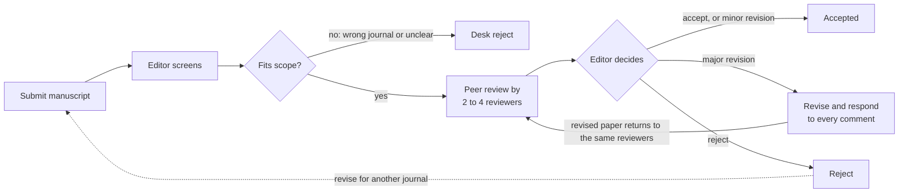

# How to Write and Publish a Paper: CERG-FLUX Lab Guide

**CERG-FLUX Lab (Fluids, Learning and Uncertainty in compleX systems)**
Department of Mechanical and Aeronautical Engineering, University of Pretoria
Maintainer: Prof Muaaz Bhamjee | Version 1.0 | 9 October 2026

## Contents

1. [Purpose and the Lab's rules](#1-purpose-and-the-labs-rules)
2. [UP processes and resources](#2-up-processes-and-resources)
3. [From research to manuscript](#3-from-research-to-manuscript)
4. [Structure of a research paper](#4-structure-of-a-research-paper)
5. [Where to publish: choosing a journal](#5-where-to-publish-choosing-a-journal)
6. [Predatory journals and conferences](#6-predatory-journals-and-conferences)
7. [Conference papers](#7-conference-papers)
8. [How peer review works](#8-how-peer-review-works)
9. [Journals versus conferences](#9-journals-versus-conferences)
10. [Submission, revision and responding to reviewers](#10-submission-revision-and-responding-to-reviewers)
11. [Authorship, ethics and research integrity](#11-authorship-ethics-and-research-integrity)
12. [Lab pre-submission checklist and decision workflow](#12-lab-pre-submission-checklist-and-decision-workflow)
13. [Sources and further reading](#13-sources-and-further-reading)

## 1. Purpose and the Lab's rules

This guide takes a CERG-FLUX Lab (Fluids, Learning and Uncertainty in compleX systems) member from a finished piece of research to a published paper, following University of Pretoria processes. It covers journal and conference papers, how peer review works, where to publish and how to avoid predatory venues.

Two rules apply to every paper from the Lab, without exception:

1. **All publication decisions require Prof Muaaz Bhamjee's (and all authors) input and final approval.** This includes the decision to write a paper, the author list and order, the target journal or conference, the submission itself, any preprint posting, responses to reviewers, and any resubmission after rejection. Do not submit anything with the Lab's name or affiliation on it without his written sign-off.
2. **You must be able to defend every word.** The Lab applies a three-tier Intellectual Ownership Framework. A manuscript is Tier 1: the science, the argument, the method description and the interpretation of results are written by the authors. AI tools may be used for formatting, LaTeX mechanics, consistency checks, reference formatting and identifying weaknesses, never for writing the science. The test is the viva test: if you cannot independently defend a passage, it is not yours and must be rewritten.

Who this is for: Lab postgraduate students (Masters and PhD), postdocs and collaborators preparing their first papers. Experienced authors should still use the checklist in the final section.

## 2. UP processes and resources

The UP Library's [Publishing in Journals](https://library.up.ac.za/c.php?g=485435&p=11474533) page sets out a three-step checklist for publishing in a credible journal: confirm DHET accreditation, check the Impact Factor and quartile, then arrange open access funding. The Lab treats the first step as absolute: a journal that is not on the current DHET accredited list is not a venue we publish in, whatever its other merits. The table below maps each UP resource to what you use it for.

| UP resource | What it does | When to use it | Link |
| --- | --- | --- | --- |
| DHET Accredited Journals List | The Department of Higher Education and Training's master list of journals eligible for research subsidy. The list now flags delisted journals and states eligibility. The current list governs articles published in 2026 and claimed in 2027. | Before choosing a target journal. If the journal is not on the list (or is delisted), UP earns no subsidy for the article. Lab rule: if a journal is not on the current DHET accredited list, we do not publish there. | [CREST list](https://db.crest.sun.ac.za/zapublications/) |
| Journal Citation Reports (JCR) | Clarivate database of Journal Impact Factors and quartile rankings (Q1 to Q4). Access via UP library login. | To compare candidate journals on citation impact and quartile. We aim for Q1 nd Q2 only. | [JCR via UP](https://uplib.idm.oclc.org/login?url=http://jcr.clarivate.com/) |
| Transformational (Read and Publish) agreements | SANLiC agreements that let UP corresponding authors publish open access at no cost with Wiley, , Emerald, ACM, ACS, Springer Nature, Elsevier (ScienceDirect), Taylor & Francis, Royal Society of Chemistry, Company of Biologists and SAGE. | First choice for open access. Covers hybrid journals, which the APC fund does not. | [R&P agreements](https://www.library.up.ac.za/ld.php?content_id=65993708) |
| Open Access APC fund | Library-administered fund that refunds 50% or 60% of Article Processing Charges for articles in accredited, peer-reviewed, fully open access (DOAJ-listed) journals. Works on a refund basis: the author pays from a departmental cost centre first. Hybrid journals are excluded. | When the journal is fully open access and not covered by a Read and Publish agreement. | [APC fund](https://library.up.ac.za/c.php?g=1126926&p=8249883) |
| Information Specialist | Faculty-assigned librarian who helps with journal selection, databases and referencing. | Early in the process, and whenever a journal's credibility is unclear. | [Find yours](https://www.library.up.ac.za/contact/infospecialists) |
| Ethics Application Guide | UP's guide to research ethics clearance. | Before any data collection involving people, animals or sensitive data. Journals ask for the clearance number. | [Ethics guide](https://library.up.ac.za/c.php?g=485435&p=11474672) |
| Research Data Management guide | How to store, document and share research data in line with UP policy and POPIA. | When preparing a data availability statement or depositing a dataset. | [RDM guide](https://library.up.ac.za/c.php?g=356288) |
| UPSpace | UP's institutional repository for theses, dissertations and accepted manuscripts. | After acceptance, to deposit the author-accepted manuscript where the publisher permits. | [UPSpace guide](https://library.up.ac.za/c.php?g=485435&p=11439344) |
| Academic Writing guide | Library guide on scholarly writing. | While drafting. | [Writing guide](https://library.up.ac.za/c.php?g=1505780&p=11254956) |

APC refund procedure, in order: the publisher accepts the manuscript and invoices the author; the author pays the full amount from a departmental or faculty cost centre; after publication the author submits the signed [APC application form](https://library.up.ac.za/ld.php?content_id=63171672) (Dean's signature required, cost centre number in section 3.20), the detailed cost centre transactional report, the published article, proof of payment in rands and the invoice to apc.applications@up.ac.za. Check the [UP APC policy](https://library.up.ac.za/ld.php?content_id=60972273) and [procedures](https://library.up.ac.za/ld.php?content_id=60972271) before committing to any fee.

For the Lab: no APC is paid and no Read and Publish option is exercised without Prof Bhamjee's approval, since the cost centre is his.

## 3. From research to manuscript

A paper starts with one defensible contribution, not with a draft. Before writing anything, agree the following with Prof Bhamjee (and co-supervisors) in a short meeting or a one-page note:

1. **The contribution, in one sentence.** What does a reader know after your paper that they did not know before? If you cannot state it in one sentence, the work is not ready. One paper, one contribution; a second contribution is usually a second paper.
2. **The evidence.** Which results, figures and validation cases prove the contribution. For CFD, LBM and SciML work this includes mesh or resolution independence, verification against an analytical or benchmark case, and validation against experiment or an established reference.
3. **The reader.** A journal paper is written for the reviewers and readers of that specific journal. Pick two or three candidate venues now (see the sections on where to publish and on conferences) and read five recent papers from each to learn their expectations on length, depth and style.
4. **The authors.** Who contributed enough to be an author, in what order, and who is corresponding author. Settle this before drafting, not after.
5. **The timeline.** A realistic first draft date, an internal review round, and a submission date. Journal review then typically takes two to six months; budget a year from first draft to publication.

Write the manuscript in the order Springer Nature's author tutorial recommends, which is not the published order: Methods first, then Results (both can be written while the work is still running), then Introduction, Discussion and Conclusion once you know what the results mean, and Title and Abstract last because they summarise everything else. Build the figures before the Results text; the text explains the figures, not the other way round.

Lab practice: LaTeX on Overleaf is the default, shared with Prof Bhamjee (and all authors) from the first draft. Use a version-controlled repository (github.com/cerg-flux-lab) for code and data that the paper depends on, so that the Reproducibility check in the final section can be passed.

## 4. Structure of a research paper

Nearly every engineering and physics journal expects the IMRaD structure (Introduction, Methods, Results and Discussion) described in [Springer Nature's manuscript tutorial](https://www.springernature.com/gp/authors/campaigns/writing-a-manuscript/structuring-your-manuscript). Section names vary by journal, but the logic does not: context, approach, evidence, interpretation. Each section has one job.

| Section | Its job | What reviewers look for | Typical length |
| --- | --- | --- | --- |
| Title | State the contribution specifically enough to be found by search. | Keywords present; no vague words such as "study of" or "investigation into". | 10 to 15 words |
| Abstract | The paper in miniature: problem, method, main result with a number, implication. Must stand alone. | Does the stated result match the body. Is it quantitative. | 150 to 250 words |
| Introduction | Funnel from the broad problem to the specific gap, then state what this paper does. End with the contributions and the paper's layout. | Is the gap real and supported by the literature review. Is the contribution clear. | 10 to 15% of the body |
| Methods | Everything needed to reproduce the work: governing equations, numerical scheme, boundary conditions, mesh or lattice, solver settings, hyperparameters, hardware, data. | Can a competent reader reproduce it. Are symbols defined and units consistent. | As long as needed |
| Results* | What was found, presented through figures and tables, without interpretation. Report verification and validation before new results. | Are claims supported by the data shown. Are uncertainties stated. | The core of the paper |
| Discussion* | What the results mean, how they compare with prior work, limitations, and why they matter. | Honest treatment of limitations and of disagreement with other studies. | Proportionate to Results |
| Conclusion | Restate the contribution and the key numbers; state future work briefly. | No new results; no overclaiming. | 1 to 3 paragraphs |
| References | Every claim that is not yours, cited to a source you have read. | Current, relevant, correctly formatted. | 30 to 60 for a full paper |

Figures carry the argument. Make them vector (PDF or SVG) wherever possible, legible at single-column width, with axis labels, units and a colour-blind-safe palette. Each figure needs a caption that lets the reader understand it without the body text. Number equations, define every symbol at first use, use SI units and maintain a single nomenclature list.

Writing conventions for the Lab: UK English unless the journal mandates US English (check the guide for authors and note which applies); no em dashes; short sentences; active voice where the journal allows it; one idea per paragraph. Author name and affiliation: Muaaz Bhamjee, Department of Mechanical and Aeronautical Engineering, University of Pretoria, ORCID 0000-0002-2697-4589; every author must have an ORCID.

Other article types exist. A letter or short communication (typically 4 to 6 pages) reports one sharp result. A review article surveys a field and is usually invited or proposed to the editor first. A data or software paper describes a dataset or code. Each has its own structure; read the journal's guide for authors.

*Sometimes the Results and Dsicussions are combined into a single section - this is my prefered method - so use it unless the Author Guide says otherwise.

## 5. Where to publish: choosing a journal

Choose the journal before you finish the draft, and choose it on fit first and prestige second. A well-matched Q2 journal that publishes your paper beats a Q1 journal that desk-rejects it. Shortlist two or three candidates and present them to Prof Bhamjee (and co-supervisors) with the reasoning below; he (and co-supervisors) makes the final call.

| Criterion | What to check | Where |
| --- | --- | --- |
| Scope and readership | Does the journal publish papers like yours. Read five recent papers in your area from it. Check the Aims and Scope page. | Journal website |
| DHET accreditation | Is it on the current accredited list and not flagged as delisted. Lab rule: if a journal is not on the current DHET accredited list, we do not publish there. Without it UP earns no subsidy and the Lab's output counts for less in reporting. | [CREST list](https://db.crest.sun.ac.za/zapublications/) |
| Indexing | Is it in Web of Science (SCIE) or Scopus. Both are required for NRF rating evidence and for most promotion and rating panels. | [JCR via UP](https://uplib.idm.oclc.org/login?url=http://jcr.clarivate.com/), Scopus Sources |
| Impact Factor and quartile | JCR Impact Factor and quartile (Q1 to Q4) within the journal's category. Also look at Scopus CiteScore and SJR, since categories and rankings differ between the two. | JCR, [Scimago](https://www.scimagojr.com/) |
| Review time and acceptance rate | Many journals publish median time to first decision. Over six months to first decision is a cost to a PhD timeline. | Journal homepage, journal metrics page |
| Open access route | Is the journal covered by a UP Read and Publish agreement (no cost), fully open access with an APC (50 to 60% refund possible), or subscription (free to publish, paywalled to read, green open access via UPSpace). | [UP R&P agreements](https://www.library.up.ac.za/ld.php?content_id=65993708), [DOAJ](https://doaj.org/) |
| Article type and length limits | Full paper, short communication, letter. Page or word limits. Mandatory highlights or graphical abstract. | Guide for authors |
| Language and template | US or UK English, reference style, LaTeX template availability. | Guide for authors |

Use the publisher journal-finder tools as a starting point only: Elsevier JournalFinder, Springer Nature Journal Suggester, Wiley Journal Finder and IEEE Publication Recommender all take an abstract and return candidate journals. Treat their output as a list to check, not a recommendation.

Typical venues for the Lab's five pillars (a starting list for discussion with Prof Bhamjee, not an approved list):

- **CFD and multiphase flow:** Journal of Fluid Mechanics, Physics of Fluids, Computers and Fluids, International Journal of Multiphase Flow, Journal of Computational Physics, International Journal of Heat and Mass Transfer, Minerals Engineering (for hydrocyclone and process work).
- **Lattice Boltzmann Methods:** Journal of Computational Physics, Computers and Fluids, Physical Review E, Computers and Mathematics with Applications, Journal of Computational Science.
- **Scientific Machine Learning:** Journal of Computational Physics, Computer Methods in Applied Mechanics and Engineering, Engineering Applications of Artificial Intelligence, Neural Networks, Machine Learning: Science and Technology, Journal of Machine Learning Research.
- **ATLAS and CERN thermofluids and detector engineering:** Journal of Instrumentation (JINST), Nuclear Instruments and Methods in Physics Research A, Applied Thermal Engineering, IEEE Transactions on Nuclear Science. ATLAS Collaboration papers follow the Collaboration's own publication committee process, which is separate from and precedes any journal submission.
- **Quantum technologies:** Quantum, Physical Review A, Physical Review Research, npj Quantum Information, Quantum Science and Technology, IEEE Transactions on Quantum Engineering, Scientific Reports.

A note on prestige: Impact Factor measures the journal's average citations, not your paper's quality, and it varies by field. Rating and promotion panels at UP and the NRF look at the quality and consistency of the venue, the paper's own citations and the reviewer reports, not the Impact Factor alone. Aim for the best journal in which the work is a natural fit, and do not pad the paper to reach a higher-tier venue.

## 6. Predatory journals and conferences

A predatory venue takes your money and gives you a publication that counts for nothing and damages your record. UP's Library points authors to the [Think. Check. Submit.](https://thinkchecksubmit.org/) checklist for journals and [Think. Check. Attend.](https://thinkcheckattend.org/conference-checker/) for conferences, both listed on the Library's [Predatory Journals](https://library.up.ac.za/c.php?g=1126926&p=9697955) page. Run every unfamiliar venue through them.

Warning signs, any one of which is enough to stop and ask:

- An unsolicited email inviting you to submit, often praising a paper of yours, with a promise of fast review (days or a few weeks) or guaranteed acceptance.
- The journal is not on the DHET accredited list (which on its own rules it out for the Lab), not in Web of Science or Scopus, and not in DOAJ (for open access titles).
- APC not stated clearly, or only revealed after acceptance; or an unusually low fee.
- No clear statement of the peer review model; editorial board members who do not list the journal on their own institutional pages; a title that closely imitates a well-known journal.
- Publisher not a member of COPE, OASPA or STM; DOIs that do not resolve in Crossref.
- For conferences: a conference covering many unrelated disciplines, held in a tourist destination, organised by an entity that runs dozens of such events, with keynote speakers you cannot verify and proceedings in a journal that fails the checks above.

Also check the [Retraction Watch Hijacked Journal Checker](https://retractionwatch.com/the-retraction-watch-hijacked-journal-checker/): some predatory sites clone the name and ISSN of a legitimate journal. Always reach the journal through its publisher's site or the DHET list, not through a link in an email.

If in doubt, ask your Information Specialist and Prof Bhamjee before submitting. Under the Lab's rules you need his approval for every submission anyway, so there is no situation in which you submit to an unverified venue.

## 7. Conference papers

A conference paper reports work in progress or a complete but compact result to a live audience, on a fixed calendar, with lighter review than a journal. It is the right first outing for most student work and the normal way to get feedback before a journal submission.

**How a conference works.** The organisers issue a call for papers (CFP) about 6 to 9 months before the event, with a deadline. Authors submit either an abstract (200 to 500 words), an extended abstract (2 pages) or a full paper (typically 6 to 12 pages in the conference template, IEEE or Springer LNCS being the most common). A programme committee reviews submissions and returns accept, accept with revisions, or reject, usually within 2 to 3 months. Accepted authors register (fees of roughly R5 000 to R20 000 plus travel), prepare a final camera-ready paper, and present it as a 15 to 20 minute talk or a poster. The papers appear in the proceedings, published by the society or a publisher, often before or at the event. There is normally one round of review and no opportunity to revise substantially after acceptance.

**Types of submission.**

| Type | Review | Appears in | Counts for | Use it when |
| --- | --- | --- | --- | --- |
| Abstract only | Light, by the committee | Book of abstracts, no DOI | Presentation experience, networking | Early results; a talk to test an idea; no publication needed yet |
| Extended abstract | Light | Proceedings, sometimes with DOI | Minor | Workshops; preliminary findings |
| Full peer-reviewed paper in indexed proceedings | Full, 2 to 3 reviewers | Proceedings indexed in Scopus or Web of Science (IEEE Xplore, Springer LNCS, ACM DL, AIP Conference Proceedings) | DHET subsidy at half the weight of a journal article; CV; citations | A complete, bounded result that will later be extended to a journal paper |
| Journal-track or special issue | Full journal review | Journal | As a journal article | The conference partners with a journal for selected papers |

DHET subsidises peer-reviewed proceedings only when they are published in an approved index (Web of Science Conference Proceedings Citation Index, Scopus, IEEE Xplore, Springer and similar) or meet the Research Output Policy criteria, and counts them at half the unit value of an accredited journal article. A conference without indexed proceedings earns UP nothing, which does not make it worthless, but you should know what you are getting.

**Conferences relevant to the Lab** (for discussion with Prof Bhamjee; check indexing for each year's proceedings):

- Fluids and CFD: SAIMechE and SACAM (South African Conference on Computational and Applied Mechanics), ECCOMAS, WCCM, ICMF (multiphase flow), ASME FEDSM, the International Conference on CFD in the Minerals and Process Industries (CSIRO).
- LBM: DSFD (Discrete Simulation of Fluid Dynamics), ICMMES (International Conference for Mesoscopic Methods in Engineering and Science).
- SciML: NeurIPS and ICML workshops on ML for physical sciences, SIAM Conference on Computational Science and Engineering, ECCOMAS and WCCM minisymposia.
- ATLAS and detector engineering: TWEPP, IEEE NSS/MIC, the SA Institute of Physics (SAIP) annual conference, ATLAS Collaboration internal meetings and ITk weeks (these are not publications).
- Quantum: IEEE Quantum Week (QCE), SAIP, SA QuTI and SA-CERN workshops.

In the Lab, a conference paper is reviewed internally by Prof Bhamjee before submission like any other paper, and the decision to attend (and spend) is his. A conference paper should be planned as a stepping stone: present at the conference, take the feedback, extend the work by at least 30 to 50% of new material (more cases, validation, analysis), and submit the extended version to a journal. The journal paper must cite the conference paper and the cover letter must state what is new.

## 8. How peer review works

Peer review is independent experts checking that your claims are supported by your evidence before the work enters the record. It is the thing that separates a publication from a blog post, and it is why a reviewed paper carries weight in examinations, ratings and promotion. The flow below is the journal process; a conference compresses it into a single round.

The editor screens first and can reject without review; after review the usual outcome is a revision, which loops back to the same reviewers until the editor accepts or rejects.

**Review models.** In single-anonymised review the reviewers know who you are but you do not know them; this is the default in most engineering journals. In double-anonymised review neither side knows the other; many IEEE and ACM venues and a growing number of journals use it, and you must remove identifying details from the manuscript. In open review identities are disclosed and reports may be published alongside the paper (some Nature and Royal Society titles, eLife, F1000). Some physics and computing communities post preprints on arXiv before or at submission, which is public exposure without formal review.

**What the editor decides.** The editor (or associate editor) first screens for scope, format and obvious quality problems; a desk rejection at this stage takes days to a few weeks and usually means wrong journal or an unclear contribution. If it passes, the editor invites two to four reviewers; finding willing reviewers is often the slowest step. Reviewers return a report with a recommendation. The editor then issues one of: accept (rare on first submission), minor revision, major revision, reject and resubmit, or reject. A major revision means the reviewers see your paper and your response again; a minor revision is usually checked by the editor alone.

**What a reviewer report contains.** A summary of the paper in the reviewer's words (if this summary is wrong, your writing is unclear), a judgement of novelty and significance, specific numbered comments on methods, results and claims, and minor points on language and presentation. A reviewer's comment is evidence that a real reader stumbled; even where the reviewer is wrong, something in the text allowed the misreading.

**Timelines.** Desk screening, 1 to 3 weeks. First review round, 2 to 4 months in most engineering and physics journals; some are faster, some slower. Revisions are usually due within 1 to 3 months. A second round takes 1 to 2 months. Expect 6 to 12 months from submission to acceptance, and plan student timelines accordingly.

**Being a reviewer.** Postgraduates in the Lab will be invited to co-review with Prof Bhamjee. Reviewing teaches you what editors look for faster than anything else. Follow the journal's confidentiality rules: never share a manuscript under review, and never use it in your own work.

## 9. Journals versus conferences

In engineering and physics a journal article outranks a conference paper, and the Lab treats the journal article as the primary output of every project. The reasons are structural: a journal has no page limit forcing you to cut validation, it runs multiple rounds of expert review rather than one, it has no deadline pushing immature work out, and it is what examiners, NRF rating panels, DHET subsidy (full unit versus half) and promotion committees weigh most heavily. A conference paper is valuable for feedback, visibility and networking, and as a staging post, but it is not a substitute.

| | Journal article | Conference paper |
| --- | --- | --- |
| Review | 2 to 4 experts, multiple rounds, revisions expected | 2 to 3 committee members, one round, accept or reject |
| Length | As long as the work needs (typically 8 000 to 12 000 words) | Fixed, typically 6 to 12 pages |
| Timeline | Submit any time; 6 to 12 months to acceptance | Fixed deadline; decision in 2 to 3 months; appears at the event |
| Cost | Free (subscription), or covered by UP Read and Publish, or APC | Registration plus travel, typically R15 000 to R60 000 all in |
| DHET weight | 1 unit | 0.5 unit, only if proceedings are in an approved index |
| Prestige in the Lab's fields | Primary output | Supporting output |
| Best use | The complete, validated contribution | Early results, feedback, a bounded sub-result, visibility |

Two exceptions to know about. In computer science and machine learning, top conferences (NeurIPS, ICML, ICLR, CVPR) are the primary venue and are more selective than most journals; a SciML paper aimed at that community may legitimately target a conference first, and the decision is Prof Bhamjee's. In the ATLAS Collaboration, physics results are published as Collaboration papers through the ATLAS publication committee, and conference notes are a defined intermediate output; follow the Collaboration's rules.

The standard path for a Lab project is: internal seminar, conference paper on a bounded result, journal paper on the full contribution, with the journal paper citing the conference paper and containing substantial new material. Never publish the same results in two venues; that is duplicate publication and both can be retracted.

Preprints (arXiv, SSRN, TechRxiv) are a third route: no review, immediate visibility, a timestamp for priority, and a DOI. Most journals in the Lab's fields allow preprinting before submission, but check the journal's policy on [Sherpa Romeo](https://www.sherpa.ac.uk/romeo/) first. Posting a preprint is a publication decision and needs Prof Bhamjee's approval.

## 10. Submission, revision and responding to reviewers

Submit only after Prof Bhamjee has approved the final manuscript, the author list and the target venue in writing. The corresponding author (normally Prof Bhamjee for Lab papers, unless agreed otherwise) submits through the journal's system (Editorial Manager, ScholarOne, eJournalPress or similar).

**The submission package.** The manuscript in the journal's template; a cover letter of one page that states the contribution in two sentences, why it fits this journal, confirms the work is original and not under review elsewhere, and declares any conflicts; highlights or a graphical abstract if required; suggested reviewers (3 to 5 experts with no recent co-authorship with any author) and, if justified, reviewers to exclude; the data availability, funding and ethics statements; and ORCIDs for all authors. Keep a copy of everything submitted.

**Responding to reviewers.** This is where papers are won. Prepare a response document with three columns or blocks for every comment: the reviewer's comment quoted in full, your response, and the change made with its location in the revised manuscript. Respond to every comment, including the ones you disagree with; where you disagree, explain why with evidence and courtesy, and consider whether the text can still be clarified. Thank the reviewers once at the top, not after every point. Supply a marked-up version showing changes and a clean version. Meet the deadline; ask for an extension early if needed. Prof Bhamjee reviews and approves the response before it goes back.

**If rejected.** Read the reports after a day, not immediately. Separate the reasons: wrong fit (go to another journal), fixable flaws (fix them, then go to another journal), or fundamental flaws (more work needed). Do not resubmit the same manuscript elsewhere without addressing the reviewers' points; reviewers overlap between journals and will notice. An appeal is only worth it when a reviewer has made a demonstrable factual error that decided the outcome.

**After acceptance.** Check the proofs within the publisher's deadline (usually 48 to 72 hours), looking at equations, figure placement, units and author details, since errors introduced in typesetting are yours to catch. Sort out open access (Read and Publish or APC, per the UP section above). Deposit the author-accepted manuscript in UPSpace where the publisher permits. Add the paper to your ORCID record and the Lab website, and report it for UP's annual research output return.

## 11. Authorship, ethics and research integrity

Authorship is earned by meeting all four [ICMJE criteria](https://www.icmje.org/recommendations/browse/roles-and-responsibilities/defining-the-role-of-authors-and-contributors.html): substantial contribution to conception, design, data or analysis; drafting or critically revising the paper; approving the final version; and accepting accountability for the whole work. All four, not a majority. Someone who meets fewer than four is acknowledged, not listed. Gift authorship (adding a senior name for credibility), guest authorship (adding someone who did nothing) and ghost authorship (omitting someone who wrote substantial parts) are all misconduct.

**Lab conventions.** Author order is agreed before drafting and recorded with Prof Bhamjee. The student who did the work is usually first author; Prof Bhamjee is usually last and corresponding author; co-supervisors and collaborators are placed by contribution. Changes to the author list after submission require every author's written consent and the journal's approval. Most journals now ask for a [CRediT](https://credit.niso.org/) contributor statement listing each author's roles from the 14 defined ones (Conceptualisation, Methodology, Software, Validation, Formal analysis, Investigation, Resources, Data curation, Writing original draft, Writing review and editing, Visualisation, Supervision, Project administration, Funding acquisition); draft this with the author list.

**Affiliations and identifiers.** Department of Mechanical and Aeronautical Engineering, University of Pretoria, for all Lab members. Every author needs an ORCID and must link it in the submission system. Prof Bhamjee's affiliations for ATLAS-related papers use the phrasing "UP Institutional Representative/Team Leader within the ATLAS Collaboration at CERN". Acknowledge funders by grant number (NRF, SA-CERN, UPQuST, UP) exactly as the funder requires.

**Use of AI tools.** AI cannot be an author (ICMJE, COPE and every major publisher agree). Most journals now require disclosure of any generative AI use beyond spelling and grammar, in the Methods or Acknowledgements. In this Lab AI use is already bounded by the Intellectual Ownership Framework: formatting, LaTeX, consistency and editorial checks, and critique, never the science. State what was used and for what; the viva test applies regardless of what the journal asks.

**Integrity checks before submission.** Run the manuscript through Turnitin (UP provides access via the [Library](https://library.up.ac.za/c.php?g=485435&p=11500682)) and resolve any overlap with your own earlier work by rewriting or citing; self-plagiarism is still plagiarism. Cite every source you used, and only sources you have read; a citation suggested by any AI tool must be verified against the actual paper. Report all results honestly, including negative ones and the limitations. Keep raw simulation data, scripts, meshes and trained model weights for at least five years, in line with UP's Research Data Management policy, and prepare a data availability statement (a DOI on Zenodo or a GitHub release under github.com/cerg-flux-lab is the Lab's preferred route). Ethics clearance numbers go in the paper wherever human, animal or personal data were involved.

**Confidentiality.** Nothing from the ATLAS Collaboration, a CERN partner or an industry collaborator goes into a manuscript without the partner's written clearance. Do not place restricted or third-party confidential material into any AI tool except as UP policy and the relevant agreement permit.

## 12. Lab pre-submission checklist and decision workflow

Five approval gates, each a short note or meeting with Prof Bhamjee, and nothing leaves the Lab between them without his sign-off.

| Gate | What is decided | What you bring |
| --- | --- | --- |
| 1. Go or no-go | Whether there is a paper, and whether it is a conference or journal paper | One-sentence contribution, list of evidence, proposed authors, two or three candidate venues |
| 2. Venue | The target journal or conference, the open access route and any cost | The venue comparison from the "Where to publish" table, the accreditation and indexing check (a journal not on the DHET list is not an option), Think. Check. Submit. completed |
| 3. Manuscript | That the draft is ready for external review | The complete manuscript on Overleaf, figures final, the checklist below ticked |
| 4. Submission | Final approval to submit | Cover letter, suggested reviewers, statements, author list and CRediT roles |
| 5. Response and resubmission | Every revision, response to reviewers, appeal, withdrawal or resubmission elsewhere | The response document and marked-up manuscript |

Any preprint posting is its own decision at gate 4.

Checklist before gate 3:

- [ ] Contribution stated in one sentence in the Abstract and Introduction, and the Conclusion claims nothing more
- [ ] Every claim in Results is supported by a figure, table or number shown in the paper
- [ ] Verification (code or benchmark), validation (experiment or reference), and mesh or resolution independence reported
- [ ] Uncertainties or error bars stated where applicable
- [ ] Methods sufficient for reproduction: equations, scheme, boundary conditions, mesh or lattice, solver settings, hyperparameters, hardware, software versions, random seeds
- [ ] Every symbol defined at first use, SI units throughout, consistent nomenclature, dimensional consistency of equations checked
- [ ] Figures vector where possible, legible at single-column width, labelled axes with units, colour-blind-safe palette, captions self-contained
- [ ] UK or US English as the journal requires, no em dashes, journal template applied, word and page limits met
- [ ] Every reference read by an author and verified against the source; reference style matches the journal
- [ ] Literature review current (nothing older than the last two years missing from the key recent work)
- [ ] Turnitin report clean; overlap with own prior work rewritten or cited
- [ ] Author list and order agreed, ORCIDs collected, CRediT roles drafted, affiliations correct
- [ ] Data, code and trained models archived with a DOI; data availability statement written
- [ ] Funding, ethics and conflict of interest statements drafted; collaborator clearance obtained where required
- [ ] AI use disclosed as the journal requires, and every passage passes the viva test
- [ ] Draft shared with Prof Bhamjee on Overleaf with at least one week for his review before any deadline

## 13. Sources and further reading

Pages opened in preparing this guide:

- UP Library, [Research Guide: Publishing in Journals](https://library.up.ac.za/c.php?g=485435&p=11474533) (updated 25 August 2026)
- UP Library, [Article Processing Charges and Open Access funds](https://library.up.ac.za/c.php?g=1126926&p=8249883) (updated 27 August 2026)
- UP Library, [Predatory Journals resources](https://library.up.ac.za/c.php?g=1126926&p=9697955)
- DHET accredited journal list, hosted by [CREST, Stellenbosch University](https://db.crest.sun.ac.za/zapublications/)
- Springer Nature, [Structuring your manuscript](https://www.springernature.com/gp/authors/campaigns/writing-a-manuscript/structuring-your-manuscript)
- [Think. Check. Submit.](https://thinkchecksubmit.org/) and [Think. Check. Attend.](https://thinkcheckattend.org/)
- [ICMJE authorship criteria](https://www.icmje.org/recommendations/browse/roles-and-responsibilities/defining-the-role-of-authors-and-contributors.html) and [CRediT contributor roles](https://credit.niso.org/)
- DHET Research Outputs Policy (2015) as summarised in university research office communiqués (UCT, Rhodes, Stellenbosch); the UP Research Office holds the current UP interpretation

Further reading recommended for new authors:

- COPE, [Core practices](https://publicationethics.org/core-practices) on publication ethics
- [Sherpa Romeo](https://www.sherpa.ac.uk/romeo/) for journal preprint and self-archiving policies
- [DOAJ](https://doaj.org/) for vetted open access journals
- Joshua Schimel, *Writing Science: How to Write Papers That Get Cited and Proposals That Get Funded* (Oxford University Press, 2012)
- Hilary Glasman-Deal, *Science Research Writing for Non-Native Speakers of English* (Imperial College Press, 2010)
- Nature Masterclasses, free [Writing a research article](https://masterclasses.nature.com/) tutorial

All external figures (review times, fees, page lengths) are typical ranges as of October 2026 and vary by venue; check the venue's own pages before relying on them.

---

*Maintained in the CERG-FLUX Lab GitHub organisation (github.com/cerg-flux-lab). Propose changes by pull request; Prof Muaaz Bhamjee approves all merges.*
